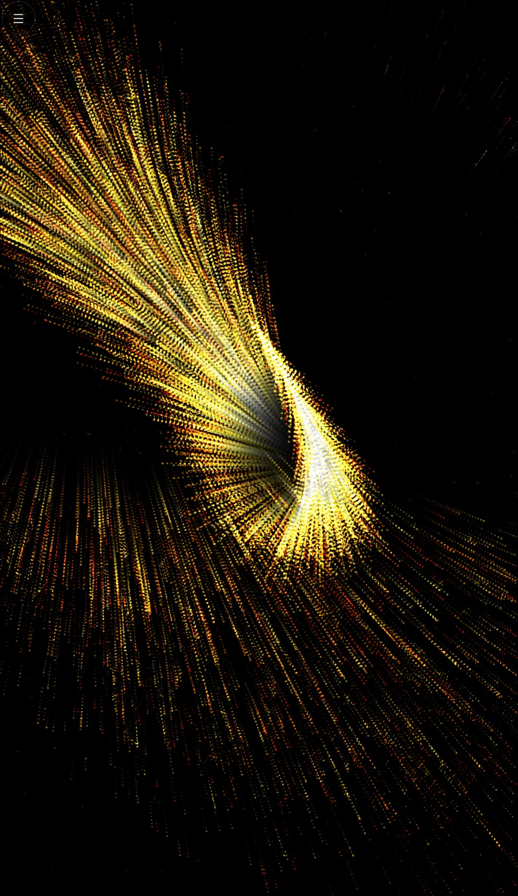
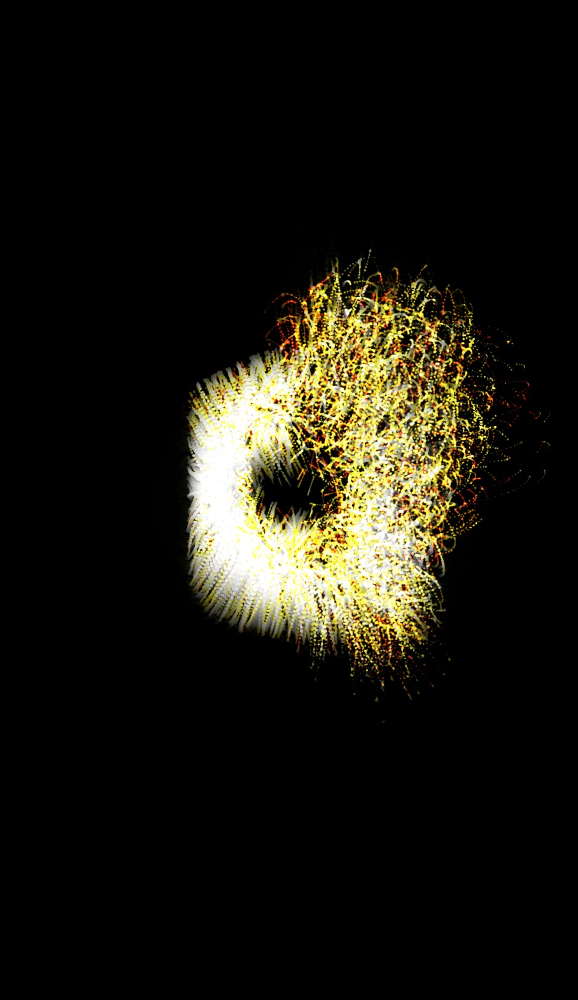
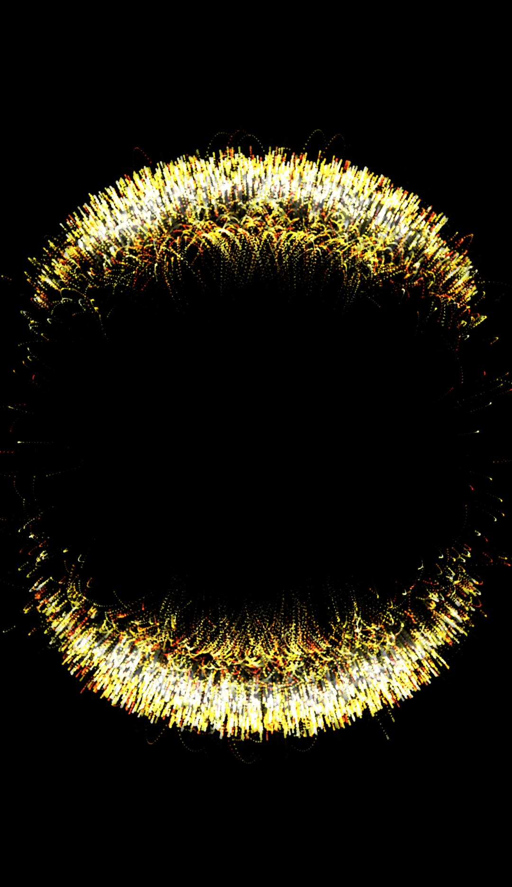
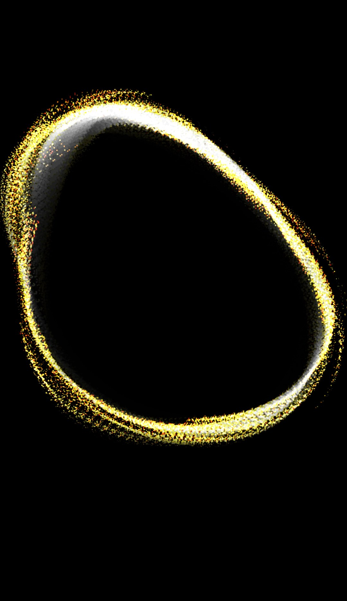

# Emberfield

Touch-driven particle art and music visualizer for Android, Windows and Linux. Thousands of glowing particles follow your fingers, or dance to the microphone and to music playing on your phone.

Free and open source (MIT), with no ads, no trackers, no accounts and no network access.

<p align="center">
  
  
  
  
</p>

<!-- Store badges go here once the listings are live (Google Play, F-Droid). -->

**Requires Godot 4.7+** (developed against 4.7.2).

**Learn the foundations:** [docs/foundation-tutorial.md](docs/foundation-tutorial.md) covers MultiMesh particles, idle drift and Vortex.
**Next:** [docs/glow-trails-tutorial.md](docs/glow-trails-tutorial.md) covers additive glow and ping-pong particle trails.

## Features

- Fourteen art modes: Pulse, Vortex, Repel, Lightning, Flow, Black Hole, Sink, Beam, Orbit, Ripple, Magnet, Fluid, Fireworks, Audio
- Audio mode: microphone or device playback, with Pulse, Equalizer, Vertical and Circular Equalizer, Swirl, Waveform, Draw and Galaxy styles. Auto gain, beat detection, Sensitivity and Smooth.
- Touch instrument: plays notes on a chosen scale as you draw
- Idle patterns: Drift, Swirl, Lattice, Boids, Rain
- Multi-touch (the effect uses the midpoint of all fingers)
- 1–12,000 particles (default 5,000), width, trail length, glow, invert
- Color presets (default Fire): White, Rainbow, Fire, Ocean, Neon, Aurora, Sunset, Mono, Candy, Sparkle
- Auto control: screensaver-style roaming with occasional mode changes (it never picks Audio, so no capture prompt appears on a timer)
- Frame rate cap (30, 60 or unlimited) for battery life on high-refresh phones
- Reduce flashing: turns off the Audio beat flash and the Lightning bolts
- Grown-up check (a math question) before choosing Playback or opening the source link, so the app is safe to hand to young kids
- Flow follows accelerometer tilt on phones
- Settings persisted to `user://settings.cfg`

## Controls

| Input | Action |
|-------|--------|
| Touch / left mouse drag | Interact with particles |
| Two+ fingers | Effect at midpoint |
| Menu button (☰) or `Esc` / `S` | Toggle settings |
| Android Back | Close settings, then exit |

## Build from a fresh clone

Playback capture is not checked in. Windows needs a GDExtension built from [`native/playback_capture`](native/playback_capture). Android needs an AAR built from [`android/plugins/playback_capture`](android/plugins/playback_capture). Microphone mode does not need either binary.

Install [Godot 4.7+](https://godotengine.org/download/), Python 3.8+, and [SCons](https://scons.org/). Windows playback also needs Visual Studio with the C++ desktop workload. The Android plugin needs JDK 17+ and Android SDK 34 or newer.

```powershell
git clone --recurse-submodules https://github.com/Troy-Story-Games/emberfield.git
cd emberfield
```

If the clone did not fetch submodules, check out godot-cpp `master`:

```powershell
git submodule update --init
```

### Windows playback library

From `native/playback_capture`, dump this editor's API next to the SConstruct, then build the editor and export libraries. `gdextension_dir` is the directory that contains `gdextension_interface.json`.

```powershell
cd native/playback_capture
& "$env:LOCALAPPDATA\Godot\Godot_v4.7.2-stable_win64_console.exe" --headless --dump-extension-api
& "$env:LOCALAPPDATA\Godot\Godot_v4.7.2-stable_win64_console.exe" --headless --dump-gdextension-interface-json
scons platform=windows target=template_debug arch=x86_64 gdextension_dir=. custom_api_file=extension_api.json
scons platform=windows target=template_release arch=x86_64 gdextension_dir=. custom_api_file=extension_api.json
```

That writes `bin/libplayback_capture.windows.template_debug.x86_64.dll` (editor) and `bin/libplayback_capture.windows.template_release.x86_64.dll` (export). godot-cpp is the `master` submodule. Its build tree stays inside the submodule and is not committed.

### Android playback library

From `android/plugins/playback_capture`:

```powershell
$env:JAVA_HOME = "C:\Program Files\Eclipse Adoptium\jdk-21.0.8.9-hotspot"
$env:ANDROID_HOME = "$env:LOCALAPPDATA\Android\Sdk"
.\gradlew.bat assembleRelease
```

`assembleRelease` writes `bin/playback_capture.aar`. An Android export also runs that build when the AAR is missing, using the Android SDK and JDK paths from **Editor Settings → Export → Android**. Rebuild it after changing the plugin, then export again. Godot only creates the `PlaybackCapture` singleton when the AAR manifest contains `org.godotengine.plugin.v2.PlaybackCapture`.

### Open in Godot

1. Import this folder as a project (or open `project.godot`)
2. Press Play (`F5`)

```powershell
& "$env:LOCALAPPDATA\Godot\Godot_v4.7.2-stable_win64.exe" --path .
```

## Export

Presets are in [`export_presets.cfg`](export_presets.cfg). Keystore passwords are not in that file; Godot keeps them in `.godot/export_credentials.cfg`.

| Preset | Output | Use |
|--------|--------|-----|
| Android | `export/Emberfield.apk` | GitHub releases, sideloading |
| Android Play | `export/Emberfield.aab` | Google Play upload |
| Windows Desktop | `export/Emberfield.exe` | |
| Linux | `export/Emberfield.x86_64` | |

### Android

1. In Godot: **Editor → Editor Settings → Export → Android**, set SDK/JDK paths and debug keystore (or create one).
2. Install Android Build Template if prompted (**Project → Install Android Build Template**).
3. Build the playback AAR if it is not already in `android/plugins/playback_capture/bin/` (see above). The export does this itself when the file is missing.
4. Allow `RECORD_AUDIO` and `POST_NOTIFICATIONS`. The plugin manifest also adds `FOREGROUND_SERVICE` and `FOREGROUND_SERVICE_MEDIA_PROJECTION`. The **PlaybackCapture** editor plugin (already enabled) packages the AAR.
5. **Project → Export → Android → Export Project**

The app targets API 36 and supports API 24+. Playback capture needs Android 10 (API 29); Microphone mode works on every supported version.

### Desktop

Export with the Windows or Linux preset. Embed PCK is enabled by default.

## Playback capture

Godot can record the microphone. It cannot hear other apps. Audio mode's **Playback** source uses a native `PlaybackCapture` singleton on each platform. Both feeds go into a muted `Analyze` bus, so playback is not heard twice. Capture runs only while Audio mode is active.

| Platform | Where | What it does |
|----------|--------|----------------|
| Windows editor and export | [`native/playback_capture`](native/playback_capture) | WASAPI loopback of the default output device (speakers and Bluetooth headphones are the same path). Switching the default device reopens the stream. |
| Android (API 29+) | [`android/plugins`](android/plugins) | `AudioPlaybackCapture` from a media-projection foreground service, so it keeps running (with its notification) while you switch to your music app. The mix is taken before the speaker or headphone route. Android shows the system consent dialog each time capture starts. Some music apps opt out; the settings row then says capture is blocked. |

Microphone capture stays in Godot (`audio/driver/enable_input` in `project.godot`) and closes whenever the app goes to the background. If the Android plugin is not in the package, Playback reports that the plugin is missing and Microphone still works.

[`native/playback_capture`](native/playback_capture/playback_capture.gdextension) is a GDExtension. A background thread captures interleaved stereo frames from the default render device. `src/` is ignored by the Godot importer so MSVC `.obj` files are not treated as meshes. The API dump and everything under `bin/` are gitignored.

The Android library is Kotlin: a media-projection foreground service, `AudioPlaybackCapture` at 48 kHz stereo, and a ring-buffer bridge that Godot polls. Its manifest registers `org.godotengine.plugin.v2.PlaybackCapture` and adds `RECORD_AUDIO`, the media-projection foreground-service permissions, and `POST_NOTIFICATIONS`. `compileOnly` is `org.godotengine:godot:4.5.1.stable` (the engine supplies those classes at runtime). [`addons/playback_capture`](addons/playback_capture) passes the AAR to the Android export. Gradle output, `.gradle/`, and the AAR are gitignored.

## Privacy

Audio is analyzed in memory and never recorded, stored or transmitted. The Android build requests no internet permission. Full policy: [docs/privacy.md](docs/privacy.md).

## Developer tools

Scripts in [`tools/`](tools) are excluded from exports.

| Command | What it does |
|---------|--------------|
| `godot --headless --path . -s res://tools/bench.gd` | Frame time for every mode and audio style at 5k and 12k particles |
| `godot --headless --path . -s res://tools/settings_fit.gd` | Checks every settings page fits a 1080x1920 phone without scrolling; exits 1 if one overflows |
| `godot --path . -s res://tools/screenshot.gd -- --out=<path> --mode=<n> [--panel]` | Scripted drag, then screenshots |
| `godot --path . -s res://tools/audio_demo.gd -- --out=<path> --style=<n>` | Plays a synthetic track into the muted analyzer and screenshots an Audio style |
| `python tools/make_icon.py`, then `godot --headless --path . -s res://tools/make_icons.gd` | Regenerates the icon SVGs and the Android and store PNGs |

## Project layout

```
scenes/          Main, particle canvas, settings UI
scripts/         Simulator, touch, auto-control, settings, UI theme
scripts/art_modes/   Pulse, Vortex, Repel, Lightning, Flow, Black Hole, Sink, Beam, Orbit, Ripple, Magnet, Fluid, Fireworks, Audio
scripts/audio/   Analyze bus, microphone, playback resample
shaders/         Trail fade + invert composite
native/playback_capture/   Windows WASAPI loopback (godot-cpp submodule on master)
android/plugins/ PlaybackCapture Android plugin sources and Gradle wrapper
addons/playback_capture/   Builds the AAR on Android export when it is missing
icon/            App icon sources and generated Android icons
fastlane/        Store listing text, icon, feature graphic, screenshots (Play and F-Droid)
docs/            Tutorials, privacy policy, F-Droid recipe draft
tools/           Benchmark, screenshot, audio demo and icon scripts (not exported)
export/          Build output dir
```

## License

MIT — see [LICENSE](LICENSE).
